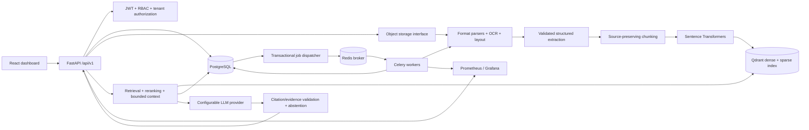
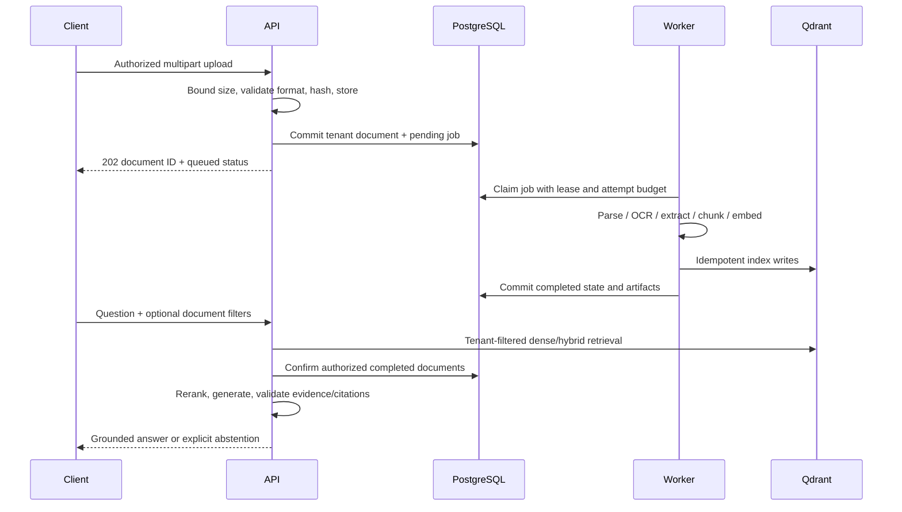

# Architecture

DocuMind is a modular monolith with an independently deployed worker. This diagram
describes the target architecture; `progress.md` identifies implemented components.

## Ownership and boundaries

`api/v1` owns HTTP serialization and authorization dependencies. `core` owns typed
configuration, database lifecycle and telemetry. `models` defines relational
integrity. Repositories will require a trusted tenant context. Services own parsing,
retrieval and RAG logic; integrations own external clients. Workers own expensive
processing, attempt budgets, leases and state transitions. Evaluation invokes the
same retrieval/RAG paths as user queries, with versioned inputs.

PostgreSQL persists tenants, users, documents, chunks, jobs, conversations, messages,
search history and evaluation runs. Every tenant-owned entity carries a tenant ID.
Composite foreign keys prevent references to another tenant's parent entity.
Queries still require explicit tenant predicates: foreign keys are not access control.
Documents have queued/processing/completed/failed states. Unique tenant/hash pairs
provide deduplication; unique document/chunk index pairs support idempotent indexing.

## Request flows

## Reliability and security

Index writes and SQL commits cannot share a transaction. Indexing must use stable
chunk IDs and retries; document completion is the visibility gate. Deletion must
first make the document unavailable in SQL and then clean index/storage artifacts.
Jobs record sanitized failure categories rather than exception text or document
content. Logs use server-generated request IDs, route templates and durations;
credentials, raw URLs/query strings and request bodies are excluded.

Liveness only reports process health. Readiness independently checks PostgreSQL
connectivity and migration revision, Redis PING and Qdrant readiness, using bounded
timeouts. A healthy API does not imply workers/models are ready; worker health is a
separate probe. Prometheus is internal to Compose; production ingress must expose
only application routes. TLS termination, backups, retention, malware scanning and
perimeter controls are deployment responsibilities, not claims of this foundation.

## Primary references

- [Qdrant monitoring endpoints](https://qdrant.tech/documentation/ops-monitoring/monitoring/)
- [Qdrant native hybrid queries](https://qdrant.tech/documentation/hybrid-queries/)
- [Celery task acknowledgement and retry semantics](https://docs.celeryq.dev/en/stable/userguide/tasks/)
